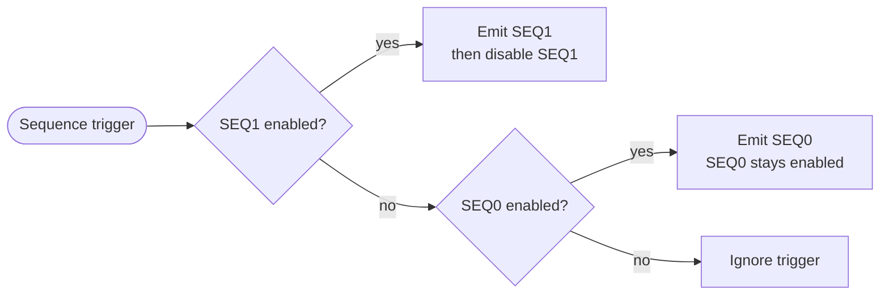
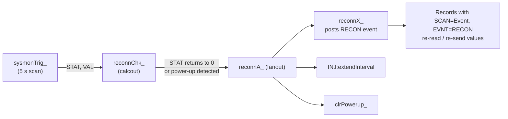

# Dual Event Generator — EPICS Support

> [!NOTE]
> **DualEventGeneratorSupport docs:** [Overview](README.md) · [EPICS Support](EPICSnotes.md)<br>
> **Related projects:** [Hardware ↗](https://gitlab.lbl.gov/alsu-instrumentation/dual-evg/-/blob/HEAD/documentation/Hardware.md) · [Firmware ↗](https://gitlab.lbl.gov/alsu-instrumentation/dual-evg/-/blob/HEAD/documentation/Firmware.md) · [Timing IOC ↗](https://git.als.lbl.gov/accelerator-controls/epics/iocs/siocDualTiming/-/blob/HEAD/documentation/README.md)

## Contents

- [Introduction](#introduction)
- [Database Development](#database-development)
  - [Sequence Records](#sequence-records)
  - [Control Records](#control-records)
  - [Injection Alignment Records](#injection-alignment-records)
  - [Latency Measurement](#latency-measurement)
  - [Hardware Triggers](#hardware-triggers)
  - [Software Triggers](#software-triggers)
  - [System Monitor Input Records](#system-monitor-input-records)
  - [Sequencer Status Input Records](#sequencer-status-input-records)
  - [String and Identification Records](#string-and-identification-records)
  - [Communication Statistics Records](#communication-statistics-records)
  - [FPGA Update on Reconnect](#fpga-update-on-reconnect)
- [IOC Startup Script](#ioc-startup-script)
- [Operator Screens](#operator-screens)
- [Support Scripts](#support-scripts)

---

## Introduction

This support module and soft IOC provide **ASYN drivers** to control and acquire data from the ALS dual event generator. The module consists of C source, a database, and Phoebus engineering screens.

The dual event generator provides timing and RF signals for each ALS frequency domain. Each generator produces continuous heartbeat, pulse-per-second, and time-of-day events, as well as sequences of events triggered by assorted conditions.

The IOC talks to the FPGA over UDP:

| UDP port | Purpose |
|--:|---|
| 58762 | EPICS commands and readbacks |
| 58763 | Sequencer status publish/subscribe |

### Sequence memories

Each generator has two sequence memories, **SEQ0** and **SEQ1**. When a sequence trigger arrives:



### EVG1 — Injector

- Sequences are normally triggered by an FPGA clock running at the injection rate (≈ 0.7 Hz), but can be triggered manually when this clock is disabled.
- **SEQ0** holds the default sequence. It triggers the booster ramp power supplies but **not** the electron gun, linac, or other injection/extraction components. Because SEQ0 stays enabled, it runs continuously — without IOC intervention — while the trigger clock is enabled.
- The timing IOC requests an actual injection cycle by writing the desired sequence to **SEQ1** and enabling it with `E1:SEQ1:enable`.
- The [dual timing IOC](https://git.als.lbl.gov/accelerator-controls/epics/iocs/siocDualTiming/-/blob/HEAD/documentation/TimingIOC.md) runs the injector in **single-shot mode**: it holds `INJ:injCycleEnable` at 0 and triggers each cycle with `INJ:singleShot`, sending a default (mode 0) sequence itself when no request arrives.
- The FPGA provides [status information](#sequencer-status-input-records) so the timing IOC can stay synchronized with the event sequences.
- Trigger requests are delayed until the next **60 Hz power line marker**, then until the next **booster/accumulator ring coincidence** (see [`INJ:syncMode`](#injection-alignment-records)). If the hardware 60 Hz marker is absent, an internal 60 Hz clock is used so the injection cycle isn't held off indefinitely.

### EVG2 — Accumulator and storage rings

EVG2 drives the ALS accumulator and storage rings and their transport lines. IOC sequence trigger requests are delayed until the next **accumulator/storage ring coincidence**, then further by the value of the [`swapoutTrigger`](#control-records) record.

---

## Database Development

The example application ships with a database (`eventGenerator.db`, built from `eventGeneratorSup/Db/eventGenerator.substitutions`) containing all records below.

> [!NOTE]
> - All record names begin with the macros `$(P)$(R)`. Only the remainder of each name is shown below.
> - `$(PORT)` expands to the port name given in the [`eventGeneratorConfigure`](#ioc-startup-script) command.
> - ASYN links use the form `@asyn($(PORT), address, timeout)`.
> - Records whose names **end in an underscore** are internal to the IOC — clients should not read or write them.

### Sequence Records

#### Sequence waveforms

These records set the pattern and timing of event codes emitted when a sequence is initiated.

```
record type: waveform
FTVL = "LONG"
NELM = "2048"
DTYP = "asynInt32ArrayOut"
INP  = "@asyn($(PORT), 0x30es, 1)"   # e = EVG index (0/1), s = sequence (0/1)
```

Entries are **`delay, event, category` triples**:

| Element | Meaning |
|---|---|
| delay | Number of transmitter clocks (≈ 8 ns) to wait before emitting the event. `0` emits events in adjacent slots. |
| event | Event code (low 8 bits). |
| category | Sequence category (low 8 bits). See the [category delay records](#category-delays-and-status-2). |

> [!IMPORTANT]
> - The element count must be a non-zero multiple of 3, or the driver rejects the write with *Invalid table size*.
> - The table must end with event code **127** (`0x7F`), or the driver rejects it with *No end-of-sequence*. Entries after the first 127 are ignored.
> - Delays below 2<sup>24</sup> − 1 (≈ 134 ms) fit in a single protocol word; longer delays take an extra word. The FPGA memory blocks hold 28-bit delays, so delays ≥ 2<sup>28</sup> cycles (≈ 2.1 s) consume multiple memory entries and reduce the number of entries that fit.

| Name | Address | Description |
|---|:---:|---|
| `E1:SEQ0` | `0x3000` | EVG1, sequence 0 — default injector sequence. Usually left unwritten since the FPGA loads a default from flash at startup. |
| `E1:SEQ1` | `0x3001` | EVG1, sequence 1 — alternate injector sequence, automatically disabled after being emitted. |
| `E2:SEQ0` | `0x3010` | EVG2, sequence 0 — AR/SR swap-out sequence. |
| `E2:SEQ1` | `0x3011` | EVG2, sequence 1 — not normally used. |

#### Sequence enables

| Name | Address | Type | Description |
|---|:---:|:---:|---|
| `E1:SEQ0:enable` | `0x1300` | bo | Enable/disable EVG1 sequence 0 |
| `E1:SEQ1:enable` | `0x1301` | bo | Enable/disable EVG1 sequence 1 |
| `E2:SEQ0:enable` | `0x1310` | bo | Enable/disable EVG2 sequence 0 |
| `E2:SEQ1:enable` | `0x1311` | bo | Enable/disable EVG2 sequence 1 |

### Control Records

```
DTYP = "asynInt32"
OUT  = "@asyn($(PORT), xxx, 0)"
```

| Name | Address | Type | Description |
|---|:---:|:---:|---|
| `clrPowerup_` | `0x1000` | longout | Part of the [update-on-reconnect](#fpga-update-on-reconnect) mechanism. Clears the FPGA *power up* status. |
| `fetchTOD` | `0x1002` | longout | Resynchronize time of day with the NTP server. Value is ignored. |
| `INJ:singleShot` | `0x1003` | longout | Generate an injection cycle request when processed. Value is ignored. Effective only when repetitive injection requests are disabled. |
| `FPGA:reboot` | `0x1F00` | longout | Writing `1`, `100`, `10000` in order forces an FPGA reset. |
| `INJ:injCycleEnable` | `0x1F01` | bo | Enable/disable (1/0) injection cycle start requests, which initiate EVG1 SEQ1 if enabled. FLNK to `INJ:forcerbk_`, which processes `sysmonTrig_`. |
| `swapoutTrigger` | `0x1F02` | longout | Generate a swap-out cycle start request (EVG2 SEQ1 if enabled, else SEQ0 if enabled, else ignored). Delayed to the next AR/SR coincidence, then by this many EVG2 clocks. |
| `MGT:Tx:realign` | `0x1F03` | longout | Writing `1`, `10`, `100` in order resets the high-speed serial transmitter and forces realignment. |
| `INJ:extendInterval` | `0x1F04` | ao | Seconds (0–20, ms resolution) to extend the injection cycle interval. Autosaved and re-sent on reconnect. |
| `Ex:diagOut` | `0x140y` | mbbo | EVG *x* (1/2) diagnostic outputs, *y* = *x* − 1. `DTYP = asynUInt32Digital`, `OUT = "@asynMask($(PORT), 0x140y, 0xFFFF, 0)"`. See [below](#diagnostic-output-modes). |
| `Ex:loopback` | `0x150y` | longout | Crosspoint switch channel (1–36) to loop back to the FPGA for round-trip latency measurement, *y* = *x* − 1. Writing causes the matching `Ex:latency` record to process. |

#### Diagnostic output modes

Set by the `Ex:diagOut` records:

| State | Raw value | Output 0 | Output 1 |
|:---:|:---:|---|---|
| 0 | `0x000` | Low | Low |
| 1 | `0x010` | High | Low |
| 2 | `0x020` | Low | High |
| 3 | `0x030` | High | High |
| 4 | `0x100` | Transmitter clock (RF/4) | Reference clock (RF/4) |
| 5 | `0x200` | Transmitter clock (RF/4) | Heartbeat marker |
| 6 | `0x300` | Transmitter clock (RF/4) | *Other* generator's heartbeat marker — useful for confirming coincidence |
| 7 | `0x400` | BR/AR alignment or AR orbit clock | Heartbeat marker |
| 8 | `0x500` | BR/AR alignment or SR orbit clock | Heartbeat marker |
| 9 | `0x600` | BR/AR or AR/SR coincidence | Heartbeat marker |
| 10 | `0x700` | F1/F2 coincidence | F1/F2 alignment |

### Injection Alignment Records

These records select how injection requests are aligned. The selection records are autosaved and re-sent to the FPGA on reconnect.

| Name | Address | Type | Description |
|---|:---:|:---:|---|
| `INJ:alignSel` | (`0x1600` via `INJ:alignSel_`) | mbbo | Injection alignment: `0` = ALSU BR/AR, `1` = ALS BR/SR |
| `INJ:hbSel` | (`0x1601` via `INJ:hbSel_`) | mbbo | Injection heartbeat: `0` = ALSU 126e6, `1` = ALS 124e6 |
| `INJ:syncMode` | (`0x1900` via `INJ:syncMode_`) | mbbo | `0` = Sync only, `1` = Sync + RF coincidence |
| `INJ:tgtARBucket` | (`0x1800` via `INJ:tgtARIdx_`) | longout | Target AR bucket, 1–304 (sent to the FPGA as bucket − 1) |
| `INJ:alignSelRBV` | — | mbbi | Readback of the alignment selection |
| `INJ:hbSelRBV` | — | mbbi | Readback of the heartbeat selection |
| `INJ:injSyncModeRBK` | — | mbbi | Readback of the sync mode, from `INJ:injCycleCSR` bits 2:1 |
| `INJ:stBRBucket` | — | calc | Target BR bucket, from `E1:seqStatus2` bits 15:0 (+1) |
| `INJ:stAlignCount` | — | calc | Target alignment count, from `E1:seqStatus2` bits 31:16 |

The selection readbacks come from `INJ:alignStatus_` (`0x0300`), which processes whenever `INJ:alignSel_` or `INJ:hbSel_` is written.

### Latency Measurement

Processing `Ex:loopback` forces the matching `Ex:latency` record to process (after a 10 ms delay to let the measurement settle).

```
record type: ai
DTYP = "asynInt32"
INP  = "@asyn($(PORT), 0x020y, 0)"   # y = x − 1
EGU  = "ns", ESLO = 0.5
```

- Records also process every **10 seconds**.
- The value is the **round-trip time in ns** for a ping from the event generator to the event receiver selected by the crosspoint switches in the event generator and fanout modules.
- The value for a given receiver varies with the amount of buffering in the transceivers.
- Internal helper records `Ex:latencyRb_` are not for client use.

### Hardware Triggers

Set the event code emitted when a hardware trigger input goes from **light to no light** (1 → 0). Values are autosaved.

| Field | Value |
|---|---|
| Name | `Ee:HW:c` — *e* = 1/2, *c* = 1…8 |
| DTYP | `asynInt32` |
| OUT | `@asyn($(PORT), 0x12xy, 1)` — *x* = *e* − 1, *y* = *c* − 1 |

> [!NOTE]
> The database defines eight triggers per generator, but only the first six inputs are wired on the rear panel.

### Software Triggers

Each software trigger is controlled by two longout records:

| Record | Purpose |
|---|---|
| `Ee:SW:c` (*e* = 1/2, *c* = 1…4) | Sets the event code to emit. Autosaved. |
| `Ee:SW:c:trig` | Emits the event code held in `Ee:SW:c` when processed. `DTYP = asynInt32`, `OUT = "@asyn($(PORT), 0x110x, 1)"`, *x* = *e* − 1. |

All four triggers of a generator share the same address; the event code is what distinguishes them.

### System Monitor Input Records

```
SCAN = "I/O Intr"
DTYP = "asynInt32"
INP  = "@asyn($(PORT), xxx, 1)"
```

Processed via `$(P)$(R)sysmonTrig_` (scanned every 5 s). **All temperatures are in °C.**

#### FPGA and board

| Name | Address | Type | Description |
|---|:---:|:---:|---|
| `FPGA:temp` | `0x2101` | ai | FPGA internal temperature |
| `FPGA:VccINT:V` | `0x2201` | ai | FPGA VccINT supply voltage |
| `FPGA:VccAUX:V` | `0x2102` | ai | FPGA VccAUX supply voltage |
| `FPGA:VccBRAM:V` | `0x2202` | ai | FPGA VccBRAM supply voltage |
| `Marble:PIO_` | `0x2003` | longin | Marble port expanders |
| `Marble:Vin` | `0x2206` | ai | Board supply voltage |
| `Marble:Iin` | `0x2306` | ai | Board supply current |
| `U28:temp` | `0x2319` | ai | Board temperature monitor (U28) |
| `U29:temp` | `0x2419` | ai | Board temperature monitor (U29) |
| `fan1:speed` | `0x2325` | ai | Fan 1 speed (RPM) |
| `fan2:speed` | `0x2425` | ai | Fan 2 speed (RPM) |
| `fan3:speed` | `0x2326` | ai | Fan 3 speed (RPM) |
| `fan4:speed` | `0x2426` | ai | Fan 4 speed (RPM) |

#### FMC power

| Name | Address | Type | Description |
|---|:---:|:---:|---|
| `FMC1:V12` | `0x2204` | ai | FMC 1 12 V supply voltage |
| `FMC1:I12` | `0x2304` | ai | FMC 1 12 V supply current |
| `FMC2:V12` | `0x2205` | ai | FMC 2 12 V supply voltage |
| `FMC2:I12` | `0x2305` | ai | FMC 2 12 V supply current |

#### Fiber transceivers

*x* = event generator (1, 2); *y* = transceiver (1, 2, 3).

| Name | Address | Type | Description |
|---|:---:|:---:|---|
| `Ex:Txy:Vcc` | `0x2107, 09, …` | ai | Transmitter supply voltage |
| `Ex:Txy:temp` | `0x2407, 09, …` | ai | Transmitter temperature |
| `Ex:Rxy:Vcc` | `0x2108, 0A, …` | ai | Receiver supply voltage |
| `Ex:Rxy:temp` | `0x2408, 0A, …` | ai | Receiver temperature |
| `Ex:Rxy:enabled` | `0x2113–18` | longin | Bitmap of enabled receivers. Bit 0 = first fiber pair on the cassette, bit 11 = last. |
| `Ex:Rxy:lowPower` | `0x2213–18` | longin | Bitmap of receivers with low input power. Valid only for enabled receivers. |

#### Clock alignment

| Name | Address | Type | Description |
|---|:---:|:---:|---|
| `E1:refCoinc` | `0x211A` | longin | EVG1 reference clock coincidence alignment point |
| `E1:refJitter` | `0x221A` | ai | EVG1 reference clock jitter (ps) |
| `E1:txCoinc` | `0x211B` | longin | EVG1 transmitter clock coincidence alignment point |
| `E1:txJitter` | `0x221B` | ai | EVG1 transmitter clock jitter (ps) |
| `E1:frequency` | `0x201C` | ai | EVG1 reference clock frequency (MHz) |
| `E2:refCoinc` | `0x211D` | longin | EVG2 reference clock coincidence alignment point |
| `E2:refJitter` | `0x221D` | ai | EVG2 reference clock jitter (ps) |
| `E2:txCoinc` | `0x211E` | longin | EVG2 transmitter clock coincidence alignment point |
| `E2:txJitter` | `0x221E` | ai | EVG2 transmitter clock jitter (ps) |
| `E2:frequency` | `0x201F` | ai | EVG2 reference clock frequency (MHz) |
| `EVG:aligned` | `0x2120` | bi | Both event generators aligned to both RF references |

#### Status

| Name | Address | Type | Description |
|---|:---:|:---:|---|
| `INJ:injCycleCSR` | `0x2021` | longin | Injection cycle control/status register (see below) |
| `TOD:Status` | `0x2022` | longin | Time-of-day source status (see below) |
| `swapoutstatus_` | `0x2024` | longin | Swap control status. MSB sets when heartbeat misalignment with coincidence is detected. |
| `E1:MGTstatus_` | `0x2027` | longin | EVG1 raw MGT status |
| `E2:MGTstatus_` | `0x2028` | longin | EVG2 raw MGT status |
| `INJ:AlignstatusSlow_` | `0x2029` | longin | Injection alignment status |
| `swapoutAlignstatusSlow_` | `0x202A` | longin | Swap-out alignment status |
| `E1:EVIOstatus_` | `0x2123` | longin | EVG1 EVIO raw status (see below) |
| `E2:EVIOstatus_` | `0x2223` | longin | EVG2 EVIO raw status |

<details>
<summary><strong>Status register bit fields</strong></summary>

**`INJ:injCycleCSR`**

| Bits | Meaning |
|---|---|
| 31 | Hardware 60 Hz power line marker invalid (0) / valid (1) |
| 30 | Booster/accumulator bucket alignment coincidence marker unsynchronized (0) / synchronized (1) with heartbeat |
| 23:8 | Injection cycle time in ms, minus two |
| 2:1 | Sync mode: 0 = Sync only, 1 = Sync + RF coincidence |
| 0 | Injection cycle disabled (0) / enabled (1) |

**`TOD:Status`**

| Bits | Meaning |
|---|---|
| 31:16 | Time-of-day state machine state |
| 1 | Time-of-day seconds invalid (0) / valid (1) |
| 0 | Pulse-per-second signal invalid (0) / valid (1) |

**`Ex:EVIOstatus_`**

| Bits | Meaning |
|---|---|
| 13:8 | Hardware trigger inputs 1–6 (1 = light, 0 = no light) |
| 0 | Diagnostic input state |

**`Ex:MGTstatus_`**

| Bits | Meaning |
|---|---|
| 4 | MGT loss of lock (exposed as `Ex:MGTLossOfLock`) |

</details>

> [!TIP]
> - The EVIO and MGT raw status records forward-link to `mbbiDirect` records of the same name **without** the trailing underscore, exposing the individual bits.
> - `Ex:MGTLossOfLock` (bi) reports `Locked`/`Unlocked` from bit 4 of `Ex:MGTstatus`.
> - `INJ:injCycleCSR` forward-links to the `INJ:injCycleEnabled` mbbi record, which tracks its least significant bit, and to `INJ:injSyncModeRBK`.

### Sequencer Status Input Records

```
record: $(P)$(R)Ex:seqStatus   (longin)
SCAN = "I/O Intr"
DTYP = "asynInt32"
INP  = "@asyn($(PORT), 0x010y, 1)"   # y = x − 1
```

These records are updated from the FPGA using a **publish/subscribe** technique that minimizes latency between a value changing in the FPGA and the record updating. Record time stamps are set by the FPGA when the status is transmitted.

| Bits | Description | Exposed as |
|---|---|---|
| 0 | Sequence 0 (the default) enabled | `Ex:seq0Enabled` |
| 1 | Sequence 1 enabled (auto-disabled after emission) | `Ex:seq1Enabled` |
| 2 | Currently active, or most recently completed, sequence | `Ex:seqSelected` |
| 3 | Event generator is emitting a sequence | `Ex:seqActive` |
| 4 | Set when a sequence starts. Cleared when the last event is emitted — or, for EVG1, when the event marked in the [default sequence `.csv`](https://gitlab.lbl.gov/alsu-instrumentation/dual-evg/-/blob/HEAD/documentation/Firmware.md#defaultsequencecsv-format) is emitted. | `Ex:seqBusy` |
| 15–8 | Incremented each time a sequence is triggered — unambiguously detects that a sequence was emitted. | `Ex:seqRequestsAccepted` |
| 23–16 | Incremented each time a trigger is ignored because a sequence was already active — unambiguously detects overruns. | `Ex:seqRequestsIgnored` |
| 28–24 | Number of bits in the sequence generator memory address. | — |

The counter fields guarantee the record value changes (and thus processes) even if the *active* bit (3) toggles faster than the FPGA update rate.

> [!TIP]
> **Detecting a completed sequence:** check that bit 3 is low and that bits 15–8 have changed.

#### Start/finish counters

Each `Ex:seqStatus` record forward-links to `Ex:seqFanout_`, which processes the bit-field calc records above plus a pair of counters:

| Record | Increments when… |
|---|---|
| `$(P)$(R)Ex:seqStarts` | Bit 4 (mask `0x10` in field **B**) goes 0 → 1 |
| `$(P)$(R)Ex:seqFinishes` | That bit goes 1 → 0 (takes the value of `Ex:seqStarts`) |

Clients can monitor these to synchronize with the start or end of a sequence.

#### Category delays and status 2

Also published by the FPGA with each status update:

| Name | Address | Type | Description |
|---|:---:|:---:|---|
| `Ex:seqCatDelay0` … `Ex:seqCatDelay3` | `0x05cy` | longin | Sequencer category delay *c* (0–3), *y* = *x* − 1 |
| `Ex:seqStatus2` | `0x060y` | longin | Sequencer status register 2, *y* = *x* − 1. For EVG1 it feeds `INJ:stBRBucket` and `INJ:stAlignCount`. |

### String and Identification Records

| Name | Type | INP | Description |
|---|---|---|---|
| `firmwareBuildDate` | stringin (`asynOctetRead`) | `@asyn($(PORT), 0x0000, 0)` | Firmware build date. Processed on IOC startup and FPGA reconnect. |
| `softwareBuildDate` | stringin (`asynOctetRead`) | `@asyn($(PORT), 0x0001, 0)` | Software build date. Processed on IOC startup and FPGA reconnect. |
| `gitID` | longin (`asynInt32`) | `@asyn($(PORT), 0x0002, 1)` | 32-bit Git hash ID. Processed at startup. |

### Communication Statistics Records

```
record type: longin
DTYP = "asynInt32"
INP  = "@asyn($(PORT), xxx, 0)"
```

`Cmd0RetryCount` scans every 10 seconds and forward-links through the rest of the chain.

| Name | Address | Description |
|---|:---:|---|
| `CmdxRetryCount` | `0xF00x` | Commands acknowledged after *x* retries (*x* = 0…4). |
| `CmdFailedCount` | `0xF005` | Commands never acknowledged. |
| `StatConnCount` | `0xF006` | Sequence status subscription successes |
| `StatRecvCount` | `0xF007` | Sequence status monitoring packets received |
| `SeqMissedCount` | `0xF008` | Sequence status monitoring packets lost in transit |

### FPGA Update on Reconnect

The IOC automatically restores FPGA settings after an FPGA restart:



Records re-sent on the `RECON` event include the build date strings, `Ex:diagOut`, `Ex:loopback`, `INJ:alignSel`, `INJ:hbSel`, and `INJ:syncMode`.

---

## IOC Startup Script

FPGA communication is configured at IOC startup with `eventGeneratorConfigure`. Arguments must be in this order:

| # | Argument | Description |
|:---:|---|---|
| 1 | `port` | ASYN port name. Arbitrary, but must match the `PORT` used in the `dbLoadRecords` command that loads the database. |
| 2 | `host` | IPv4 address of the dual event generator FPGA. |
| 3 | `priority` | Port thread priority. `0` gives the default medium priority. |

The packaged `eventGenerator.iocsh` snippet does this and loads the database:

```
eventGeneratorConfigure("$(PORT)", "$(IP)", 0)
dbLoadRecords("$(TOP)/db/eventGenerator.db", "P=$(P), R=$(R), PORT=$(PORT)")
```

It also loads `asynRecord.db` instances `$(P)$(R)asynCMD` and `$(P)$(R)asynSEQ` for the `$(PORT)_CMD` and `$(PORT)_SEQ` ports, for tracing. The example `st.cmd` in `iocBoot/iocDualEventGenerator` defaults to `P=EVG:` (prefixed with `test` unless `DUAL_TIMING_IOC_TEST` is set) and `IP=192.168.1.146`.

---

## Operator Screens

Phoebus screens are in `op/bob` (launch with `runPhoebus.sh`):

| Screen | Contents |
|---|---|
| `EVG_Engineering.bob` | Main engineering screen |
| `EVG_Firefly.bob` | Firefly transceiver status |
| `EVG_Supplies.bob` | Supply voltages and currents |
| `EVG_injectionEnable.bob` | Injection enable control |
| `EVG_loopback.bob` | Loopback latency measurement |
| `EVG_resets.bob` | Reboot and realignment controls |
| `EVG_statistics.bob` | Communication statistics |
| `EVG_triggers.bob` | Hardware and software triggers |

---

## Support Scripts

Located in `<TOP>/scripts`:

| Script | Purpose |
|---|---|
| `console.py` | Connect to the FPGA console. `-a` sets the target address (default `131.243.93.169`). See [Console Commands](https://gitlab.lbl.gov/alsu-instrumentation/dual-evg/-/blob/HEAD/documentation/Firmware.md#console-commands). |
| `Latencies.py` | Scan all channels and report loopback times. Options: `-c` cycles, `-i` interval, `-p` record prefix (default `EVG:`), `-v` verbose, `-z` show invalid readbacks. Fanout recursion is not implemented yet (FIXME in source). |
| `ClockAlignmentCheck.py` | Check ALS-U refClk/txClk alignment. |
| `SequencerTest.py` | Dual event generator sequencer example. |
| `showOldEVG.sh` | `camonitor` the legacy MRF event generator soft-sequence PVs. |
